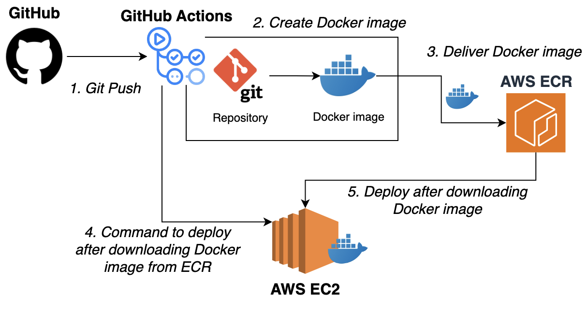
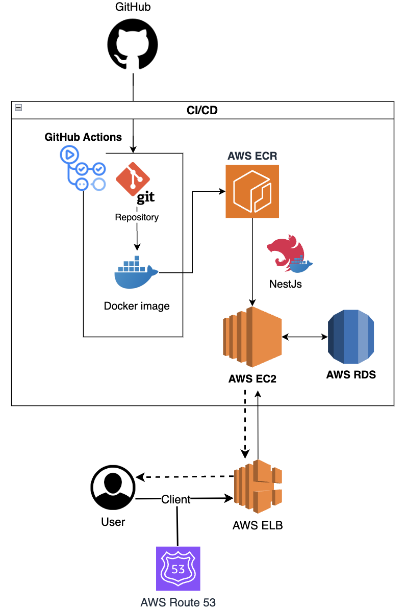
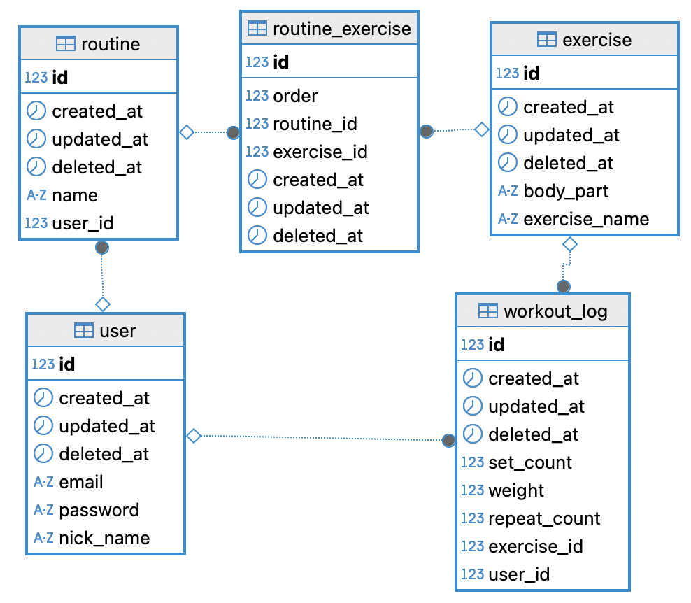

# GymLog

A backend system for workout tracking with a focus on data performance and automated infrastructure.

### 🧩 Key Features
- **📥 Scalable Data Ingestion**: RESTful API design for real-time workout tracking.
- **📈 500x Query Optimization**: Reduced latency from 2s to 0.004s via Multi-column Indexes and Redis.
- **✅ 170+ Automated Tests**: 152 Unit and 18 E2E tests ensuring data and logic accuracy.
- **☁️ Cloud Infrastructure**: Automated AWS provisioning (EC2, RDS, ECR) using CloudFormation.
- **🔄 CI/CD Pipeline**: Fully automated deployment with GitHub Actions and Docker.
    

### 🔍 Notable API Endpoints
All analytics and aggregations are performed based on the authenticated user's personal workout history.

- **Time-series Data Aggregation**
  - `GET /workout-logs/year?` : Retrieves aggregated workout data for a specific year
  - `GET /workout-logs/year-month?` : Provides detailed exercise breakdowns for a specific year and month.
  - Aggregates and retrieves exercise breakdown of all exercises performed by a user in a given year.

- **Peak Performance Analytics**
  - `GET /workout-logs/best` :  Identifies the personal best (Max weight) for each exercise within the user's records.


## 🛠️ Tech Stack
#### 📦 Backend:    

#### 🗄️ Data Storage & Modeling:  

#### ⚡ Performance & Caching: 

#### 🚀 Cloud & Data Infrastructure
- **CI/CD**:  
- **Infrastructure**: -Deployed-FF9900?logo=amazonaws&logoColor=white)
- **IaC**: **AWS CloudFormation** (Automated infrastructure setup for consistent environment replication)

#### 🔎 Reliability & Testing: 

#### 🧰 Tools:  


## ✨ Key Contributions
### 🔄️ Implemented CI/CD pipeline

Built a fully automated pipeline for seamless environment replication and delivery.

- Pipeline Automation: Engineered a GitHub Actions workflow for automated deployment to AWS EC2.
- Containerization: Standardized deployment environments using Docker and AWS ECR.
- Security: Managed sensitive environment variables securely via GitHub Secrets.

This diagram illustrates and explains the CI/CD pipeline used in this project.


### 📈 MySQL Performance Optimization
Optimized large-scale data retrieval on 1M+ records through strategic indexing.

- **500x Speedup**: Reduced query latency from 2s to 0.004s.
- **Comparative Analysis**: Evaluated Multi-column indexes vs. Denormalization vs. Redis.
- **Hybrid Solution**: Implemented Multi-column indexes + Redis caching for optimal performance and flexibility.

<p align="left">
  👉 <a href="./docs/MySQL_Query_Optimization.pdf" target="_blank">
    <strong>Technical Case Study</strong>
  </a>
   : Detailed Analysis of SQL Tuning & Caching
</p>

## ☁️ Infrastructure & Architecture

### 🖼️ An Overview of AWS Architecture



### 📜 Infrastructure as Code (AWS CloudFormation)
*Automated the entire environment provisioning to ensure consistency and reliable scalability.*

**Key Resources**
- 🖥️ **EC2**: Runs the Dockerized NestJS backend
- 🗄️ **RDS (MySQL)**: Stores user, routine, and workout log data
- 🌐 **ALB (Application Load Balancer)**: Routes public traffic to EC2
- 📦 **ECR**: Stores backend Docker images
- 🛡️ **IAM Role**: Allows EC2 to pull images from ECR


### 🚀 Infrastructure Deployment Guide
**CloudFormation Template Location**: `template/cloudformation-template.yaml`

#### **1. Configuration Parameters**
- **Compute**
  - `KeyName`: EC2 SSH key pair (e.g., my-keypair)
  - `InstanceType`: EC2 instance family (Default: t3.micro)
  - `VolumeSize`: EBS storage size in GiB (Default: 20)

- **Networking**
  - `VpcId`: Target VPC ID for resource deployment
  - `Subnet1`, `Subnet2`: Subnet IDs for Multi-AZ (ALB & RDS)

- **Database**
  - `DBInstanceIdentifier`: Name of the RDS instance in AWS console
  - `DBName` & `DBUsername`: Initial database and master user name
  - `DBPassword`: Master password for database authentication

#### **2. How to Deploy**

##### **Option A: Deploy via AWS Console**
1. Go to the AWS CloudFormation page on the AWS website.
2. Choose “Create stack → With new resources (standard)”
3. Upload `cloudformation-template.yaml`
4. Fill in the parameters and deploy

##### **Option B: Deploy via AWS CLI**

```bash
aws cloudformation deploy \
  --stack-name gymlog-infra \
  --template-file template/cloudformation-template.yaml \
  --capabilities CAPABILITY_NAMED_IAM \
  --parameter-overrides \
    KeyName=my-keypair \
    VpcId=vpc-xxxxxxxx \
    Subnet1=subnet-xxxxx \
    Subnet2=subnet-yyyyy \
    DBInstanceIdentifier=gymlog-db \
    DBName=mydata \
    DBUsername=admin \
    DBPassword=YourSecurePassword \
    InstanceType=t3.micro \
    VolumeSize=20
```
##### ⚠️ Make sure to replace each parameter (e.g., KeyName, VpcId, Subnet1, etc.) with the actual values from your AWS environment before executing the command.


## ⚙️ Git Flow
- `master`: Main branch for release-ready code
- `develope`: Integration branch for ongoing development
- `feature`: Feature development branches


## ✅ Deploy Instructions using GitHubActions

**GitHub Secrets Configuration**
- **AWS Access**: `AWS_ACCESS_KEY_ID`, `AWS_SECRET_ACCESS_KEY`
- **EC2 Access**: `EC2_HOST`, `EC2_PRIVATE_KEY`, `EC2_USERNAME`
- **Application Config**: `ENV` (Add the entire block below as one secret)

parameters in ENV
```
JWT_SECRET=your_jwt_secret_key     # ← Replace with your actual JWT secret key
JWT_EXPIRESIN=1h                   # ← Replace with the desired JWT expiration time (e.g., 1h, 30m, 15s)
DB_HOST=AWS_RDS_HOST_ADDRESS       # ← Replace with your actual host ip in AWS RDS 
DB_PORT=3306
DB_NAME=your_database_name         # ← Replace with your actual database name
DB_USERNAME=your_mysql_username    # ← Replace with your actual MySQL username
DB_PASSWORD=your_password          # ← Replace with your actual MySQL password
SALT_ROUNDS=xxx                    # ← Replace with the number of salt rounds to use (e.g., 10)
PORT=80
FE_DOMAIN=https://xxx.com          # ← Replace with actual front-end domain address
```

Push the code to the `main` branch to deploy this service using GitHub Actions


## ✅ Test Instructions

### Test Environment Setup

Create a `.env.test` file in the root directory with the following content:

```
JWT_SECRET=your_jwt_secret_key     # ← Replace with your actual JWT secret key
JWT_EXPIRESIN=1h                   # ← Replace with the desired JWT expiration time (e.g., 1h, 30m, 15s)
DB_HOST=localhost
DB_PORT=3306
DB_NAME=your_database_name         # ← Replace with your actual database name
DB_USERNAME=your_mysql_username    # ← Replace with your actual MySQL username
DB_PASSWORD=your_password          # ← Replace with your actual MySQL password
SALT_ROUNDS=xxx                    # ← Replace with the number of salt rounds to use (e.g., 10)
PORT=3000
HOST_IP=127.0.0.1
DB_SYNCHRONIZE=false

```

### Execute Tests

#### E2E tests
```bash
npm run start:e2e
```

#### Layer tests
```bash
npm run start:layer
```


## ⛓️ DataBase ERD



`user`: Stores account information such as email, name, and password.

`exercise`: Contains information about each exercise name and body part.

`routine`: Represents each user’s workout plan

`workout_log`: Logs each workout session with weight, repetitions, and set count.

### Entity Relations
#### user ↔︎ routine (1:N)
- A user can create multiple routines. 

#### user ↔︎ workout_log (1:N)
- A user can create multiple workout_logs. 

#### exercise ↔︎ workout_log (1:N)
- Each log records one exercise session.

#### routine ↔︎ exercise (M:N)
- A routine consists of multiple exercises. 
- An exercise can have multiple routines
- `routineExercise` connects routine and exercise


## 🗂️ Project Structure
```
Gymlog
├── Dockerfile
├── README.md
├── .github/
│   └── workflows/
│       └── deploy.yml
├── template/
│   └── cloudformation-template.yml
└── src/
    ├── auth/
    │   └── application/
    ├── cache/
    ├── common/
    │   ├── const/
    │   ├── dto/
    │   ├── infrastructure/
    │   ├── jwtPassport/
    │   ├── logger/
    │   ├── type/
    │   └── validation/
    ├── routineExercise/
    │   ├── application/     # service layer (use cases)
    │   ├── domain/          # domain entities and repository interfaces
    │   ├── dto/             # data transfer objects
    │   ├── infrastructure/  # integration with external resources (e.g., DB, Redis)
    │   └── test/            # unit and e2e tests
    ├── user/
    ├── exercise/
    ├── routine/
    └── workoutLog/
    └── Each domain module (user, exercise, routine, workoutLog) has the same structure
        ├── application/     # service layer (use cases)
        ├── domain/          # domain entities and repository interfaces
        ├── dto/             # data transfer objects
        ├── functions/       # shared business logic utilities
        ├── infrastructure/  # integration with external resources (e.g., DB, Redis)
        ├── presentation/    # controllers (HTTP layer)
        └── test/            # unit and e2e tests

```
